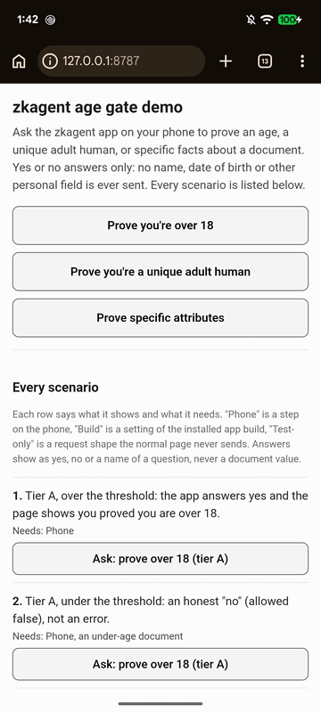

```
   ┌───────────────────────────────┐
   │   chip in ──────→ 1 bit out   │
   │   (and nothing else, ever)    │
   └───────────────┬───────────────┘
                   │
               zkagent
```

> The NFC chip already in your passport or ID card answers one question, such as "over 18?", with true or false and nothing else.

<p align="center">
  
  
  
</p>

<p align="center">
  
</p>
<p align="center"><sub>One "over 18" check with the local demo (debug build): the site asks, the phone reads the chip, the site gets "over 18: yes" and nothing else. Document details are blurred.</sub></p>

---

## What it is and why

zkagent delivers a **working verification model**: a binary, non-leaking verifier you can use today, or take, modify and customise without starting from scratch. It has many knobs to open or change: `operator.json`, tiers, age thresholds, hostname pin lists and evidence plugs. The goal is achieved: your identity can be verified inline without revealing one more detail about who you are. The aim is to stop sharing document scans online, even with an employer.

- **The problem:** age checks are spreading, and today's tools (ID uploads, face scans, issuer-run wallets) collect far more than the question needs. Sites also want "one real person, once" without learning who. Agent-auth standards root trust in a vendor or an account, never in a human. [8een](https://github.com/hamr0/8een) walked the EU's age-verification design and showed the limits of the mdoc approach: it needs an issuer, an enrolment step and a wallet.
- **The idea:** governments already issued a credential, the signed chip in your passport or ID card. zkagent reuses it. No new issuer, no enrolment, no account.
- **How it works:** the phone reads the chip over NFC and checks the government's own signature (ICAO 9303 passive authentication). The requesting site gets one answer, not the data. The document never leaves the phone and nothing from it is stored.
- **Three parts:** the Android scanner app, the `chiproof` verifier library, and a local demo site. All open source, Apache-2.0.
- **Not zero-knowledge.** zkagent uses no ZK circuits of its own. Privacy comes from minimal disclosure: one bit out, a fresh single-use nonce, per-site keys, and coarsened dates. Third-party ZK proofs can be plugged in as optional evidence, never as the default.

## What's built

The latest release is v0.10.0. Built and checked on an Android Pixel 6a, mostly against the local demo (same-device link and QR code), and once end-to-end against a remote HTTPS site.

| Part | What it is | Where |
|---|---|---|
| **`chiproof`** | The verifier library a website runs. `verify()` never throws; `issueChallenge` throws on a malformed request (for example tier C without an issuer). Issues challenges, spends single-use nonces, negotiates tiers, builds and checks tier-C requests, has a pluggable evidence registry. No runtime dependencies, TypeScript types. | [npm](https://www.npmjs.com/package/chiproof) · `packages/chiproof` |
| **Scanner** | The reference Android app. Reads the chip, verifies it, asks the holder to consent with a biometric prompt, sends the answer. Settings holds the holder's switch for tier C. | [GitHub Releases](https://github.com/hamr0/zkagent/releases) (signed APK) · `apps/scanner` |
| **Demo** | A small local website that plays the requesting site, so you can run the whole loop, tier C included. | `apps/demo` |

### Two kinds of proof

| | **Tier A: anonymous** | **Tier B: unique human, per site** |
|---|---|---|
| What the site learns | "Over N?" yes or no | "Over N?" yes or no, plus a per-site tag for the document |
| Can the site recognise a repeat visit? | No. Two visits look identical. | Yes, at that one site only. A second scan of the same document shows as "already registered". |
| Can two sites link you? | No | No. The tag differs per site. |
| Signed? | No, by design | Yes, by a device key (`sig-ed25519/1` or `sig-p256/1`; StrongBox P-256, or Ed25519 where available) |
| Good for | Pure age gates | One account per person, bans that stick, anti-bot gating |

### Tier C: yes/no checks on document fields (off by default)

Tier C is mainly for government services, KYC and similar checks: it confirms document facts without the site receiving or scanning the document.

The site never gets the field itself, only a yes or no. The questions:

- the document is valid for at least 3, 6 or 12 more calendar months
- the name matches (`given_names` and `surname` sent as two fields, so no order to get wrong)
- the date of birth shows an age of at least 15, 16, 18, 21, 60 or 65
- the nationality is a given code, or is not in a short list of codes
- the document number matches

All three must be true before the app answers:

1. The operator turned tier C on in `operator.json` (`tier_c.enabled`).
2. The site's exact hostname is on the operator's `tier_c_verifiers` list. This pins a hostname, not a key, and is baked into the build.
3. The holder turned on **Allow additional verifications**. It is OFF by default; while off, only age checks (tiers A and B) leave the phone.

- The app answers every question in a request or refuses the whole request.
- A refused site sees only a generic "refused". The reason shows in the app only.
- A build with tier C on but no pin list, or a pin list but tier C off, fails to build.
- Checked on a US passport and a Dutch ID card, shipped in 0.9.0. Not zero-knowledge. Limits: [Honest limits](#honest-limits).

### Age thresholds

- Fixed list: **over 15, 16, 18, 21, 60 or 65**.
- Each site gets one age, locked the first time it asks, so it can't fish for your exact age. The lock is shared across tiers, tier C's date-of-birth question included.
- Exception: sites in `multi_threshold_verifiers` can ask several ages. The showcase build names none.
- Dates are coarsened to the day before comparing.
- Age checks (tiers A and B) can be open to any site: `"verifiers": "any"` in `operator.json`, as the showcase build does. An exact-hostname list stays available for a closed build. `"any"` never opens tier C.

### Features

- Chip signature checked against the German BSI CSCA masterlist; the masterlist's own signature chain is checked at load.
- Chip authentication reported where the document supports it.
- Same-device links (`av://`) or a QR code scanned with the phone's camera. No in-app scanner needed.
- The site's request is signed (ES256) and its origins must all match. A refusal is always shown as a refusal, never as success.
- Build-time config in `operator.json`: open or allowlisted age checks, plus tier C's own switch and pin list. A bad config fails the build.
- Refusals and errors show in red in the app.
- A capped scan log with no values, and a privacy policy stating nothing from the document is stored.
- Evidence plugs: device-key signatures (`sig-p256/1`, `sig-ed25519/1`), `signed-receipt/1`, and optional third-party ZK `zk-passport/1` (tier A, validation-grade).

### What it works with

- **Documents:** ICAO 9303 e-passports and chip ID cards, over BAC or PACE. Tested on a US passport and a Dutch ID card.
- **Phones:** Android with NFC. Tested on a Pixel 6a. iOS is out of scope.
- **Sites:** any Node 20+ backend, through `chiproof`. Request and response shapes follow OpenID4VP (signed request object, `direct_post` response).

## Use cases

**Built (tiers A and B):**
- **Age gates:** social media, adult content, alcohol, gambling and games, with over-15/16 for teen rules and over-18/21 for adult rules.
- **Senior checks:** over 60 or 65 for discounts and eligibility, without showing an ID.
- **One account per human:** sign-ups, free trials, giveaways and polls with one vote per person per site.
- **Bans that stick:** banning the per-site tag keeps the same person out, even under a new email address.
- **A human, not a bot:** a privacy-preserving captcha replacement.

**Built and device-checked, shipped in 0.9.0 (tier C):**
- **KYC-style yes/no checks:** name match, date of birth within a range, nationality, document valid for at least 3, 6 or 12 months, and document-number match. These are answered only to sites whose exact hostname the operator pinned, and only when the holder allows additional verifications.

**Agents (in the IETF draft, not built here):**
- **A human-rooted agent identity:** an AI agent acting for a real, unique person, who can be held accountable and banned per site, with no identity provider in the middle.

## Agent auth and the IETF

The agent half of zkagent (delegation certificates, signed agent requests, revocation) now lives in the author's individual Internet-Draft [`draft-hamr-oauth-agent-delegation`](https://datatracker.ietf.org/doc/draft-hamr-oauth-agent-delegation/). Its Appendix A, Direction 3, cites this project as a working, issuer-free human root: a per-site, pseudonymous "unique human" signal that a delegation chain can anchor in. This repository is what that reference points to. The draft is an individual submission and has no IETF endorsement.

## What it isn't

- **Not zero-knowledge.** Neither the age checks nor tier C use ZK cryptography. It's minimal disclosure.
- **Not bank-grade.** It's captcha-grade: good for uniqueness, age gates and bans that stick, not for payments or legal identity, and it isn't certified for any legal age-verification duty.
- **No face scan, no ID upload, and no issuer, enrolment or zkagent-run service** anywhere in the path.

## Honest limits

| Limit | What it means |
|---|---|
| Not proof of ownership | Passive authentication proves the chip data is genuine. It doesn't prove the person holding the phone owns the document. |
| Cloned chips | Where a document lacks chip authentication, a cloned chip answers as the real holder would. Disclosed, not mitigated. Tier B uniqueness only holds where `chip_auth` is true. |
| Several documents | A person with k documents can get up to k tags at a site: at most k, never exactly one. |
| Trust sources | Tier A is unsigned by design. The tier-B key comes from no configured trust source, because no device-attestation plug was built. |
| Narrow testing | One phone model (a Pixel 6a) and two documents, mostly against the local demo. A remote HTTPS site was reached once end-to-end, against one host. No claim about other countries, devices or sites; wide interoperability is untested. |
| Accessibility | TalkBack was found unusable and is not checked. |
| Release vs debug | Phone evidence against the local demo comes from debug builds; release APKs can't reach `127.0.0.1` by design. |

**Tier C adds these.** Each is stated in full in [`docs/product/customer-guide.md`](docs/product/customer-guide.md) section 4.1.

| Limit | What it means |
|---|---|
| Repeat questions | Nothing limits how often an approved site asks, so it can keep confirming guesses of a name, document number or nationality. Your setting is the brake: off means tier C is never answered. |
| Expiry | The 3, 6 and 12 month questions can be combined to narrow the expiry date. |
| Age | Locked to one value per site, but that one age is still one bit about the date of birth. Sites in `multi_threshold_verifiers` can narrow it down. |
| Many hostnames | The age lock is per hostname, so a party running many hostnames can ask a different age on each. |
| Document number | A "yes" links you to a number the site already had. |
| Long names | A very long name may read as "no match": the document cuts long names short, and given names must match in full. |
| The pin is a hostname | It trusts whoever controls that hostname's DNS and TLS. The list changes only with a new build. No remote revocation, no authority behind it. |
| Link-open is visible | In an open build the app must fetch the request before it knows it is tier C. An unpinned site still learns the link was opened, and from which network address, then is refused before anything is read. |

## Try it

You need an Android phone with NFC and a chip passport or ID card.

1. For real HTTPS sites, sideload the signed scanner APK from [Releases](https://github.com/hamr0/zkagent/releases). The release app allows no cleartext HTTP, so it cannot reach the local demo.
2. To try the local demo, build a debug scanner (`./gradlew :app:assembleRegularDebug`, see [`docs/product/install-and-test-guide.md`](docs/product/install-and-test-guide.md)) and install it. Then run the demo site on your computer and reach it from the phone over USB with `adb reverse tcp:8787 tcp:8787`. The steps are in [`apps/demo/README.md`](apps/demo/README.md).
3. To use the verifier in your own site, run `npm install chiproof`.

### Test it with a real phone

The demo page at `http://127.0.0.1:8787` lists every scenario the product offers (age proofs, the tier-C questions, and each way a request can be refused or go unanswered), each with one plain line saying what it shows and what it needs (a phone step, a setting of the app build, or a test-only request shape). The phone side needs the debug build (the release APK cannot reach `127.0.0.1`). Start it as in [`apps/demo/README.md`](apps/demo/README.md); `DEMO_TEST_MODE=1` adds the test-only controls. It runs on your own machine only and is never hosted.

The full walk-through, from prerequisites and building to the automated tests and a step-by-step phone test, is [`docs/product/install-and-test-guide.md`](docs/product/install-and-test-guide.md).

[`docs/product/customer-guide.md`](docs/product/customer-guide.md) explains every screen, and section 7.1 covers building and signing your own scanner.

## Reuse it

The latest release is v0.10.0 (2026-11-02): the demo becomes the local test and showcase page, and chiproof's `issueChallenge` now requires an issuer for tier C (a breaking change for sites; see the [CHANGELOG](CHANGELOG.md)). Tier C shipped in 0.9.0. zkagent has no production users and stays on 0.x. It's built to be picked apart. [`docs/product/reuse-map.md`](docs/product/reuse-map.md) lists every liftable part (the verdict core, the evidence plugs, the chip and masterlist check, the secure-hardware key, the handoff, the config gate and the publish workflow) with its maturity, evidence and caveats.

## Repo layout

- `packages/chiproof`: the verifier library (npm)
- `apps/scanner`: the Android scanner
- `apps/demo`: the local demo site
- `docs/product/zkagent-prd.md`: the spec, decisions and NO-GO table
- `docs/product/install-and-test-guide.md`: install, build, test and reuse, from a cold clone
- `docs/product/customer-guide.md`: screen-by-screen guide
- `docs/product/reuse-map.md`: parts you can lift
- `docs/wiki/backlog.md`: designed but not built, and how to revive it
- `docs/wiki/decisions.md`: the owner's decisions, with dates
- `spikes/`: the throwaway proofs of concept, one per milestone

## License

Apache 2.0. See [LICENSE](LICENSE) and [NOTICE](NOTICE).
